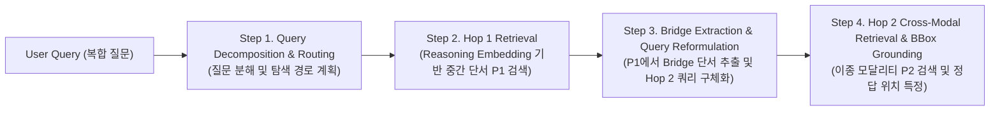

# Multi-Hop Retrieval 표준 파이프라인 정리 및 단계별 대표 논문·시나리오 적용 가이드

> **핵심 요약 (발표의 2대 기술 기둥)**
> 1. **전체 검색 프레임워크**: 우리는 **표준 Multi-Hop Retrieval 파이프라인 (`Query Decomposition / Planning → Hop 1 Retrieval → Bridge Extraction & Query Reformulation → Hop 2 Cross-Modal Retrieval & Spatial Grounding`)**을 따른다.
> 2. **Hop 간 연결 엔진**: 이때 각 Hop에서 단어를 넘어선 암묵적 중간 단서(Bridge)를 찾고 다음 Hop과 연결하는 핵심 엔진으로 **Reasoning Embedding (`Hybrid BM25 + Reasoning Dense Embedding`)**을 사용한다.

---

## 1. 논문들에서 발췌·통합한 Multi-Hop Retrieval 표준 파이프라인 (4단계)

학계의 대표 논문들(`MDR`, `IRCoT`, `Hi-Q`, `DocHop-QA`, `RAR-b / BRIGHT`)이 공통적으로 정의하는 **Multi-Hop Retrieval의 정석(De-facto Standard) 파이프라인**은 아래 4단계로 구성됩니다.

### 학계 표준 수식 표현 (논문 발췌 통합)
1. **Iterative / Sequential Formulation (`MDR`, Xiong et al., ICLR 2021)**:
   $$P_1 = \text{Retrieve}(q_0), \quad q_1 = \text{Reformulate}(q_0, P_1), \quad P_2 = \text{Retrieve}(q_1)$$
   - 원래 질문 $q_0$만으로는 최종 정답 문서 $P_2$와의 어휘/의미 겹침이 없어($\text{Sim}(q_0, P_2) \approx 0$) 직접 검색이 불가능합니다.
   - 반드시 1차 검색된 중간 문서 $P_1$의 정보를 결합해 $q_1$을 만들어야 $P_2$를 찾을 수 있습니다.
2. **Hierarchical Sub-question Decomposition (`Hi-Q`, NeurIPS 2026 & `IRCoT`, ACL 2023)**:
   $$q_0 \xrightarrow{\text{Decompose}} \{q^{(1)}, q^{(2)}(\text{bridge})\}, \quad \text{bridge} = \text{Extract}(P_1)$$
   - 복합 질문을 계층적 하위 질문으로 쪼개고, $q^{(1)}$의 검색 결과 $P_1$에서 추출한 `bridge` 변수를 $q^{(2)}(\text{bridge})$에 대입(Substitution)하여 2차 검색을 수행합니다.
3. **Cross-Modal Snippet-to-Snippet Hybrid Scoring (`DocHop-QA`, 2025/2026)**:
   $$\text{Score}(q, S) = \alpha \cdot \text{Lexical}_{\text{BM25/TF-IDF}}(q, S) + (1-\alpha) \cdot \langle E_{\text{reason}}(q), E_{\text{reason}}(S) \rangle$$
   - 링크가 없는(Unlinked) 다중 모달리티 환경에서, Hop 1의 텍스트 스니펫($S_{\text{text}}$)에서 얻은 브릿지 표현이 Hop 2의 표/이미지 스니펫($S_{\text{table/visual}}$)을 찾아내고, 최종적으로 이미지 내 **BBox 위치(Spatial Grounding)**를 지목합니다.

---

## 2. 단계별 대표 레퍼런스 논문 선정 (발표 장표 인용용 Best 5)

우리 발표의 **1) Multi-Hop Retrieval 파이프라인**과 **2) Reasoning Embedding 엔진**을 뒷받침하기에 가장 권위 있고 스토리가 딱 맞는 대표 논문 5편입니다.

| 구분 | 파이프라인 단계 | 대표 선정 논문 (학회/연도) | 논문에서 가져올 핵심 개념 (1줄 요약) | 우리 발표 슬라이드 매칭 |
| :--- | :--- | :--- | :--- | :--- |
| **기둥 1: Multi-Hop 파이프라인** | **Step 1 & 3** 계층적 질문 분해 및 Bridge 대입 | **`Hi-Q`** (**NeurIPS 2026**, POSTECH) & **`IRCoT`** (**ACL 2023**) | 복합 질문을 하위 질문 트리로 분해하고, Hop 1 결과에서 얻은 **Bridge 단서를 Hop 2 쿼리에 동적으로 채워 넣는(Interleaved)** 표준 아키텍처 | `2. Planner` `7. Re- entry` `8. Planner 2` |
| **기둥 1: Multi-Hop 파이프라인** | **Step 2 → Step 4** 2-Hop 상태 전이 정식화 | **`MDR`** (**ICLR 2021**, Meta AI) *(Dense Passage Retrieval for Open-Domain Question Answering 후속)* | 단일 홉으로 찾을 수 없는 문서를 찾기 위해 **$q_0 \to P_1 \to (q_0, P_1) \to P_2$로 이어지는 Multi-Hop Dense Retrieval**의 표준 수식을 정립한 고전 | 전체 2-Hop 루프 구조 |
| **기둥 1: Multi-Hop 파이프라인** | **Step 4** 링크 없는 멀티모달 (Text→Table/BBox) 연결 | **`DocHop-QA`** (**2025/2026**, POSTECH 등) & **`DocHop`** (**2026**, MIT/UW 등) | **하이퍼링크가 없는(Unlinked) 문서/앱**들 사이에서 **텍스트 단서(`Snippet 2`)를 징검다리 삼아 표·이미지(`Snippet 3`)의 BBox**를 찾아내는 Cross-Modal Chain-Hop 파이프라인 | `5. Hybrid Search` `11. Hybrid Search 2` `12. OCR (BBox)` |
| **기둥 2: Reasoning Embedding** | **Hop 간 연결 엔진** (암묵적 단서 추론 검색) | **`BRIGHT`** (**ICLR 2025**, Princeton/CMU) & **`RAR-b`** (**ACL 2024**, UCLA/AllenAI) | 단순 키워드·패러프레이즈 매칭을 넘어, **질문의 조건과 문서 내 암묵적 상황·역할 간의 추론적 연결(Reasoning-Intensive Retrieval)**을 임베딩 공간에서 수행해야 함을 입증 | `Reasoning Embedding` 도입 배경 및 기술 장표 |
| **기둥 2: Reasoning Embedding** | **Reasoning Embedding 학습/표현 원리** | **`ReasonIR`** (**2025**, Meta/UW) & **`JudgeRank / M- Solomon`** (**2025/2026**) | 검색기(Retriever) 자체가 표면적 단어가 아니라 **'문제-해결책', '암묵적 상황-구체적 정황'이라는 추론 브릿지(Bridge)**를 벡터 공간에서 가깝게 매핑하도록 학습 | `Reasoning Embedding` 모델 학습/성능 장표 |

---

## 3. 우리 발표(`How It Works` 12장 + 시나리오)에 어떻게 적용하고 설명할 것인가?

발표에서 심사위원들에게 **아래 4단계 프레임워크**로 설명하면, **"1) 왜 Multi-Hop Retrieval 파이프라인이 필요한지"**와 **"2) 왜 그 파이프라인이 돌아가려면 일반 임베딩이 아닌 Reasoning Embedding이 필수인지"**가 톱니바퀴처럼 맞물립니다.

---

### 단계별 파이프라인 × 우리 시나리오(`UX 2` 집들이 와인 & `UX 1` A사 보안 이슈 표) 매핑

#### **Stage 1. Query Decomposition & Planning (`Hi-Q` NeurIPS 2026 / `IRCoT` ACL 2023)**
* **우리 슬라이드**: `1. Query` → `2. Planner` → `3. Sub Query`
* **논문 원리**: 사용자는 최종 정답이 들어 있는 파일명이나 촬영 날짜를 모른 채 **'사건/상황(`지은이네 집들이`, `A사 미팅 보안 이슈`)'**으로 질문합니다. Planner는 이를 한 번에 찾으려 하지 않고, **Hop 1(상황/맥락 특정 하위 쿼리)**과 **Hop 2(최종 타겟 확인 하위 쿼리)**로 계층 분해(`Hi-Q`)합니다.
* **시나리오 적용**:
  - **와인(`UX 2`)**: *"지은이네 집들이 때 해산물 요리랑 마신 화이트 와인"* → **Sub-Query 1**: `"지은이네 집들이 날짜와 당시 식사 메뉴 단서 찾기 (카톡)"` / **Sub-Query 2**: `"[해당 날짜/식탁] 사진에서 화이트 와인 라벨 찾기 (갤러리)"`
  - **비즈니스(`UX 1`)**: *"A사 미팅 때 박 팀장님이 지적한 보안 이슈 해결책 표"* → **Sub-Query 1**: `"A사 미팅 회의록에서 박 팀장 지적사항과 합의된 해결책 찾기 (노트)"` / **Sub-Query 2**: `"[합의된 해결책] 상세 명세 표가 있는 문서 찾기 (내 파일)"`

#### **Stage 2. Hop 1 Retrieval via Reasoning Embedding (`BRIGHT` ICLR 2025 / `RAR-b` ACL 2024 / `ReasonIR`)**
* **우리 슬라이드**: `4. Edge Data` → `5. Hybrid Search` (`0.2 BM25 + 0.8 Reasoning Dense Embedding`) → `6. Data 1`
* **논문 원리 (⭐왜 Reasoning Embedding인가?)**:
  - 스마트폰의 실제 대화나 메모에는 질문의 단어(`'집들이'`, `'해결책 표'`)가 그대로 적혀 있지 않습니다.
  - 일반 임베딩(Lexical/Paraphrase)은 `'집들이'`라는 단어가 없으면 실패하지만, **Reasoning Embedding**은 질문의 요구와 문서의 **암묵적 정황(Situational/Logical Bridge)**을 벡터 공간에서 직접 연결합니다.
* **시나리오 적용**:
  - **와인(`UX 2`)**: 카톡에 `'집들이'`라는 단어가 전혀 없어도, *"어제 이삿짐 박스 다 풀었어! 휴지·세제 사 오지 말고 몸만 와~ 저녁에 광어 카르파초 해 둘게 (10/14)"*라는 문맥을 **Reasoning Embedding**이 **'집들이 초대 상황'**으로 추론하여 Hop 1 스니펫(`Data 1`)으로 정확히 건져 올립니다!
  - **비즈니스(`UX 1`)**: 회의록의 *"박 팀장 우려(망분리 환경 키 유출) → 온프레미스 KMS 프록시 적용"* 구절을 `DocHop-QA`의 **`Problem → Solution` 논리 스캐폴드**로 인식하여 중간 단서로 포착합니다!

#### **Stage 3. Bridge Extraction & Query Reformulation (`MDR` ICLR 2021 / `Hi-Q` NeurIPS 2026)**
* **우리 슬라이드**: `7. Re- entry` → `8. Planner 2` → `9. Sub Query 2`
* **논문 원리**: Hop 1에서 찾은 텍스트 스니펫(`Data 1`)으로부터 **결정적 징검다리 단서(Bridge: 날짜, 요리명, 구체적 기술명)**를 추출하여, 비어 있던 Hop 2의 쿼리를 구체화(`Reformulate`)합니다.
* **시나리오 적용**:
  - **와인(`UX 2`)**: 카톡(`Data 1`)에서 추출한 **`Bridge = [10월 14일, 광어 카르파초(해산물) 식탁]`**을 결합하여, 갤러리를 향한 2차 쿼리(`Sub Query 2`)를 구체화합니다.
  - **비즈니스(`UX 1`)**: 회의록(`Data 1`)에서 추출한 **`Bridge = [온프레미스 KMS 프록시 게이트웨이]`**를 결합하여, 문서함을 향한 2차 쿼리를 생성합니다.

#### **Stage 4. Hop 2 Unlinked Cross-Modal Retrieval & BBox Grounding (`DocHop-QA` 2025/2026)**
* **우리 슬라이드**: `10. Edge Data 2` → `11. Hybrid Search 2` → `12. OCR (BBox Highlight)`
* **논문 원리 (`DocHop-QA`의 핵심!)**:
  - 카톡과 갤러리, 삼성노트와 내 파일 사이에는 **하이퍼링크가 전혀 없습니다(Unlinked)**.
  - 또한 최종 정답은 텍스트가 아니라 **갤러리 사진(Visual OCR)이나 PDF 문서 안의 표(Table)**라는 다른 모달리티에 존재합니다.
  - `DocHop-QA`의 **`Snippet-to-Snippet Chain-Hop`** 원리에 따라, Stage 3에서 구체화된 브릿지 쿼리로 이미지/표 스니펫을 검색한 뒤, **정답 엔티티가 적힌 정확한 Bounding Box(`BBox`, Task 1)**를 지목하여 최종 답변을 생성합니다.
* **시나리오 적용**:
  - **와인(`UX 2`)**: `10/14` 갤러리 식탁 사진들 중 와인병 라벨의 OCR 텍스트(`"Cloudy Bay Sauvignon Blanc — Crisp citrus, pairs ideally with raw seafood"`)를 매칭하고, **라벨 위 와인 이름 영역에 정확한 `BBox`를 하이라이트(`12. ocr`)**하며 *"지은이네 집들이 때 광어 카르파초와 함께 마신 와인은 **클라우디 베이 소비뇽 블랑**입니다"*라고 답변합니다.
  - **비즈니스(`UX 1`)**: `'A사'`라는 단어가 전혀 없는 `Cloud_Arch_v2.pdf` 14페이지에서 **`[Table 3] 온프레미스 KMS 프록시 구간별 암호화 명세표` 영역에 `BBox`를 하이라이트**하며 해당 파일과 페이지를 즉시 열어줍니다.

---

## 4. 발표 멘트용 핵심 정리 (심사위원 설득 3문장)

발표에서 아키텍처 장표(`How It Works`)를 여실 때 딱 이렇게 말씀하시면 완벽합니다:

> 1. **"저희 온디바이스 검색 에이전트는 학계의 표준 Multi-Hop Retrieval 파이프라인(`MDR`, `Hi-Q`, `DocHop-QA`)을 모바일 환경에 맞게 최적화한 2-Hop 아키텍처를 따릅니다."**
> 2. **"스마트폰 내 앱(카톡·노트·갤러리·파일)들은 위키백과와 달리 서로 하이퍼링크가 전혀 없는 `Unlinked Multimodal` 환경(`DocHop-QA`)이기 때문에, 사용자의 첫 질문만으로는 최종 사진이나 문서 표를 직접 찾을 수 없습니다."**
> 3. **"따라서 저희는 Hop 1에서 `Reasoning Embedding`(`BRIGHT`, `ReasonIR`)을 통해 단어가 달라도 맥락상 이어지는 '중간 텍스트 단서(Bridge)'를 먼저 찾아내고, 이 단서를 징검다리 삼아 Hop 2에서 다른 앱의 표나 사진 속 정답 위치(`BBox`)를 정확히 짚어냅니다."**
